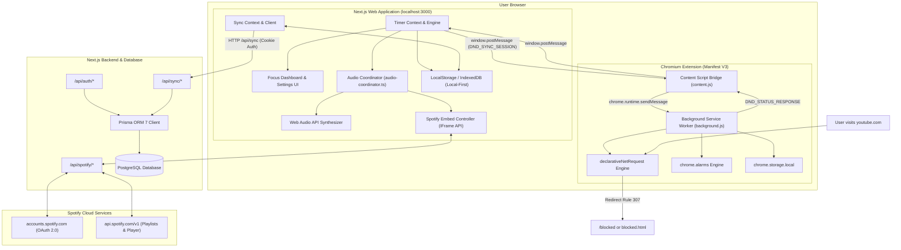
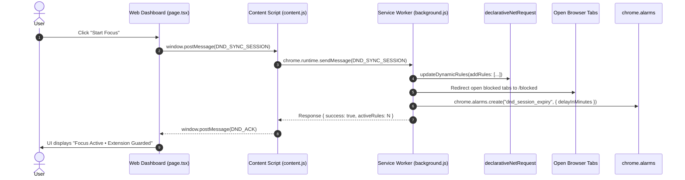

# System Architecture

This document details the system design, core modules, component interactions, and data flows of the **Do Not Disturb** platform.

---

## 1. High-Level System Architecture

Do Not Disturb consists of four primary subsystems interacting in real time:
1. **Next.js Web Application**: Serves the user interface, manages timer state, synthesizes procedural audio, coordinates Spotify playback, and provides backend API route handlers.
2. **Companion Chromium Extension**: Executes network-level request redirection via `chrome.declarativeNetRequest`, controls background alarms, and relays state via content scripts.
3. **Dual Focus Audio Engine**: Blends offline procedural Web Audio synthesizers (Rain, 40Hz Binaural Beats, Space) with the official Spotify IFrame Embed Controller, managed seamlessly via an asynchronous Audio Coordinator.
4. **Database & Cloud Sync Service**: PostgreSQL database accessed via Prisma ORM 7, providing persistence for authenticated users while supporting full offline guest operation.



---

## 2. Frontend & State Architecture

### 2.1 Next.js 16 App Router Structure

The user interface is built on Next.js 16 with the App Router model:

- `app/page.tsx`: Primary Focus Dashboard hosting the circular timer, mode selectors, daily focus summary, and ambient sound controls.
- `app/blocklist/page.tsx`: Website blocklist management interface allowing users to view, add, toggle, and delete domains, as well as inspect extension health.
- `app/statistics/page.tsx`: Session history charts, focus time totals, and deflection count metrics.
- `app/shortcuts/page.tsx`: Interactive keyboard shortcut configuration page.
- `app/settings/page.tsx`: User configuration for session lengths, break cadence, blocking strictness, and theme preferences.
- `app/connected-apps/page.tsx`: Hub for viewing and managing connected integrations (Spotify account linking, connection health, and disconnect).
- `app/callback/page.tsx`: Multi-provider OAuth callback handler (Spotify, Google) featuring single-use code exchange deduplication, opener messaging, and auto-close.
- `app/blocked/page.tsx`: Deflection destination displaying a mindful breathing interface and the time remaining in the current focus block.
- `app/admin/page.tsx`: Stealth, privacy-first Superadmin Command Center gated by `getSuperAdminUser()` (silently redirecting non-superadmins to `/`).

### 2.2 React Context Model

State management is separated into distinct single-responsibility React contexts:

1. **`TimerContext` (`context/timer-context.tsx`)**:
   - Manages timer countdown intervals, active session state (`running`, `paused`, `stopped`, `completed`), modes (`FOCUS`, `SHORT_BREAK`, `LONG_BREAK`), and cycle tracking.
   - **Daily Cycle Reset Engine**: Persists `cycleDate` (`YYYY-MM-DD`) in `PersistedTimerState`. Automatically resets the focus cycle counter back to `1` every calendar day upon date rollover, initialization from storage, tab focus, or `document.visibilitychange` events.
   - Cross-tab state synchronization via `BroadcastChannel` (`dnd-timer-channel`) and native `StorageEvent` listeners.
   - Emits synchronization events to the browser extension whenever timer state transitions occur.
   - Dispatches privacy-safe live timer status pings (`start`, `pause`, 30s `heartbeat`, `stop`) to `/api/timer/status` for real-time Superadmin telemetry across signed-in users and ephemeral local guests.
   - Triggers audio notifications and chime playback upon session completion.

2. **`SyncContext` (`context/sync-context.tsx`)**:
   - Manages authentication state (`user`, `sessionToken`) and network sync status (`idle`, `syncing`, `synced`, `offline`, `error`).
   - Implements optimistic UI updates and background synchronization with debouncing.
   - Facilitates migration of local guest data to PostgreSQL when the user signs up or logs in.

3. **`ThemeContext` (`context/theme-context.tsx`)**:
   - Manages light, dark, and system theme switching by writing appropriate CSS classes to the `document.documentElement` element.

---

## 3. Web Audio API Procedural Synthesizer

Rather than streaming heavy audio assets over the network, Do Not Disturb utilizes a procedural audio engine built on the Web Audio API (`lib/sound/sound-synth.ts`).

### 3.1 Audio Generation Models

- **Gentle Rain**:
  - Generates continuous white/pink noise via `AudioBufferSourceNode`.
  - Filters the noise through low-pass and band-pass `BiquadFilterNode` instances.
  - Modulates gain using an `OscillatorNode` (LFO at ~0.2 Hz) to simulate natural rain drops and wind gusts.
- **Focus Beats (Binaural 40Hz)**:
  - Generates two sine wave oscillators in stereo: 200 Hz on the left channel and 240 Hz on the right channel via a `ChannelMergerNode`.
  - The 40 Hz frequency difference stimulates gamma-band brainwave entrainment associated with high-focus mental states.
- **Deep Space**:
  - Combines multiple detuned low-frequency sawtooth and sine oscillators (55 Hz, 110 Hz, 165 Hz) passed through a resonant low-pass filter to generate an ambient cosmic drone.
- **Ocean Tides (`waves`)** *(Progression Unlock: Level 3)*:
  - Blends looped Brownian and pink noise through a dual-stage resonant low-pass filter (280 Hz) modulated by a 0.09 Hz sine LFO, synthesizing an 11-second rolling shoreline wave swell.
- **Zen Wind (`forest`)** *(Progression Unlock: Level 5)*:
  - Filters pink noise through a resonant bandpass filter (540 Hz) and adds a subtle 880 Hz harmonic overtone with gentle vibrato, modulated by an organic 0.14 Hz canopy gust LFO.
- **Tibetan Singing Bowl / Meditation Chime**:
  - Synthesized dynamically on session completion using decaying sinusoidal partials (harmonic frequencies: 528 Hz, 1056 Hz, 1584 Hz) with exponential gain decay ramps (`exponentialRampToValueAtTime`).

### 3.2 Spotify Integration & Dual Audio Architecture

Do Not Disturb pairs its procedural synthesizer with the official Spotify IFrame Embed Controller (`components/spotify/spotify-focus-player.tsx`):

1. **Unified Audio Coordinator (`lib/sound/audio-coordinator.ts`)**:
   - Offers three operating modes: `ambient` (synthesizer only), `spotify` (Spotify only), and `both` (ambient rain or beats layered gently under Spotify tracks).
   - Listens to `TimerContext` lifecycle events: automatically starts playback when focus begins (`playFocusAudio`), pauses playback during short and long breaks (`pauseFocusAudio`), and halts playback on session reset.
   - Dispatches instantaneous playback commands (`play`, `pause`, `resume`, `toggle`, `next`, `prev`) across windows and tabs via `BroadcastChannel("dnd-spotify-command-channel")` and custom DOM events.
2. **Track Memory & Session Continuity**:
   - The embed controller listens to Spotify `playback_update` events and stores the currently active track URI (`lastPlayedTrackUri`) in `localStorage`.
   - When users pause to take a break or step away, resuming the timer continues playback on the same track rather than resetting to the first song of the playlist.
3. **Picture-in-Picture Mini Window**:
   - Synchronizes now-playing artwork, artist name, and track title from `current-track-store.ts` directly into the floating desktop PiP window (`components/mini-timer-window.tsx`).
   - For full technical details and sequence flows, refer to the [Spotify Integration Guide](spotify-integration.md).

---

## 4. Companion Extension Integration

The browser extension bridges web application state to browser-level HTTP request filtering using Chromium Manifest V3.

### 4.1 Cross-Context Messaging Protocol

Because regular web pages cannot directly invoke privileged `chrome.*` APIs, a three-step bridge is used:

1. **Web App Window**: The web application dispatches a DOM message:
   ```typescript
   window.postMessage({
     source: "DND_WEB_APP",
     type: "DND_SYNC_SESSION",
     requestId: "req_123",
     session: activeSessionPayload,
     domains: activeBlockedDomains,
     redirectUrl: "https://www.donotdistrb.com/blocked"
   }, "*");
   ```
2. **Content Script Bridge (`content.js`)**:
   - Injected into matched origins (`https://*.donotdistrb.com/*`, `http://localhost:3000/*`, `https://*.vercel.app/*`).
   - Automatically registers the active origin on load via `DND_REGISTER_ORIGIN`.
   - Listens for window messages with `source: "DND_WEB_APP"`.
   - Relays the message to the background service worker using `chrome.runtime.sendMessage`.
3. **Background Service Worker (`background.js`)**:
   - Processes the request and configures `chrome.declarativeNetRequest` dynamic rules.
   - Instantly deflects any currently open tabs matching the target domains via `chrome.tabs.update`.
   - Stores session state in `chrome.storage.local`.
   - Schedules a `chrome.alarms` timer for automatic unblocking.
   - Returns an acknowledgment message back down the chain to update the web UI.



---

## 5. Local-First & Cloud Synchronization Architecture

### 5.1 Storage Priority & Offline Operation

Do Not Disturb operates on a **Local-First** design pattern:
- **Guest Users**: All session logs (with goals, milestones, and notes), custom timer presets, blocklists, shortcuts and master toggles, UI visual themes, active focus anchors, granular deflection event logs, streak metrics, Flow XP, level tiers, and unlocked achievements are persisted in the browser's `localStorage` and `IndexedDB`. No network calls or accounts are required.
- **Authenticated Users**: On signup (`/api/auth/register`) or login (`/api/auth/login`, `/api/auth/google`), the entire local guest state is automatically pushed, seeded into PostgreSQL, and merged bi-directionally via `/api/sync`. Subsequent mutations update both local cache and PostgreSQL.

### 5.2 Conflict Resolution

When reconciling client and server state:
- **Blocklist**: Union of unique normalized hostnames (`example.com`). If active flags differ, client takes precedence during an explicit local toggle.
- **Settings & Presets**: Most recently updated timestamp (`updatedAt`) wins. Reconciles timer durations, break cadences, strict blocking, completion chime, acoustic presets, volume levels, and `autoPlayAudio` (timer auto-play). Custom presets are matched by name and deduplicated.
- **UI Preferences & Toggles**: Visualizer mode (`__visual_mode__`), shortcut master toggles (`__shortcuts_enabled__`), and active focus anchors (`__primary_anchor__`, `__session_intent__`) are persisted as metadata entries.
- **Sessions & History**: Idempotent insert based on session ID (`cuid`) and start timestamp. Focus goals, intent milestones, and post-sprint retrospective notes are fully preserved.
- **Deflection Events**: Granular deflection event logs are matched by timestamp and URL, mapped to the user's blocked website entities, and cumulatively appended.
- **Gamification & Flow XP**: Progress-preserving reconciliation. The highest `level` and cumulative `totalXp` win, available `streakTokens` and intercepted `totalShieldsRepelled` take the maximum value, and unlocked achievements are reconciled as a set union across all authenticated devices.

---

## 6. Security & Authentication Architecture

1. **Authentication Engine (Auth.js / NextAuth v5)**:
   - Configured in `auth.ts` and exposed via App Router route handlers at `app/api/auth/[...nextauth]/route.ts`.
   - Providers: Credentials (email & password with scrypt verification) and Google OAuth 2.0.
   - Session Strategy: JWT session tokens with a 30-day (`maxAge: 30 * 24 * 60 * 60`) expiry window.
   - Server Access: Accessed anywhere on the server using `auth()` or `getCurrentUser()`.
   - Client Access: Wrapped in `<AuthProvider>` (`SessionProvider`), exposing `useSession()`, `signIn()`, and `signOut()`.
2. **Password Hashing**: Uses Node.js native `crypto.scryptSync` with unique 16-byte cryptographically secure salts. Hash format: `<salt>:<derivedKey>`.
3. **Cookie Attributes**:
   - `HttpOnly`: Inaccessible to client JavaScript, preventing XSS-based token theft.
   - `SameSite: Lax`: Protects against Cross-Site Request Forgery (CSRF).
   - `Secure`: Enforced in production environments.
   - `Path: /`: Available across all Next.js API routes.
4. **Extension Security**:
   - `externally_connectable` and `content_scripts` origins are strictly scoped to approved application hosts.
   - Content script ignores messages missing the proper `source` and structure.
5. **Superadmin Authorization & Privacy-First Telemetry**:
   - Controlled via environment variable allowlisting (`SUPERADMIN_EMAIL` / `SUPERADMIN_EMAILS`) validated on the server via `isSuperAdminEmail()` and `getSuperAdminUser()` in `lib/auth.ts`.
   - `/admin` is unindexed, omitted from public navigation, and enforces `k`-anonymity (`k >= 2`) on global domain leaderboards, redacts personal focus anchors, and masks user emails by default.
6. **Spotify OAuth 2.0 & AES-256-GCM Session Encryption**:
   - Spotify access and refresh tokens are decoupled from the PostgreSQL database and stored in an HTTP-only cookie (`dnd_spotify_session`).
   - The token payload is encrypted and authenticated using AES-256-GCM with a 32-byte key derived from `AUTH_SECRET`, randomized 12-byte IVs, and 16-byte authentication tags.
   - OAuth CSRF protection is enforced via cryptographically secure single-use state tokens persisted in `dnd_spotify_oauth_state` with a 10-minute expiry window.
   - Access tokens are automatically refreshed in the background with a 60-second safety buffer before expiry.
