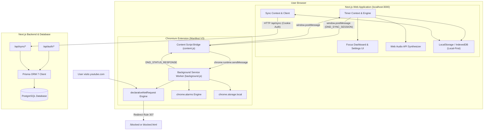
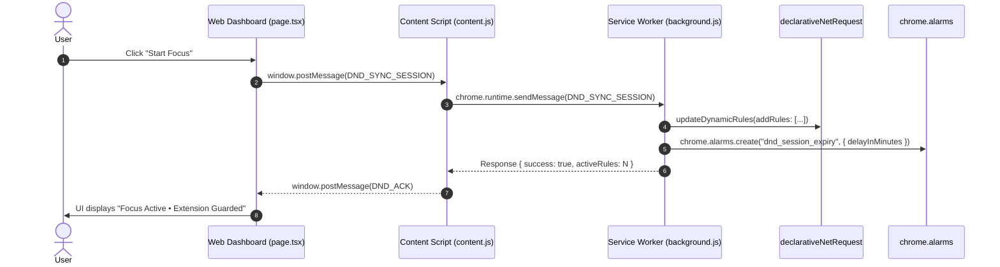

# System Architecture

This document details the system design, core modules, component interactions, and data flows of the **Do Not Disturb** platform.

---

## 1. High-Level System Architecture

Do Not Disturb consists of three primary subsystems interacting in real time:
1. **Next.js Web Application**: Serves the user interface, manages timer state, synthesizes procedural audio, and provides backend API route handlers.
2. **Companion Chromium Extension**: Executes network-level request redirection via `chrome.declarativeNetRequest`, controls background alarms, and relays state via content scripts.
3. **Database & Cloud Sync Service**: PostgreSQL database accessed via Prisma ORM 7, providing persistence for authenticated users while supporting full offline guest operation.



---

## 2. Frontend & State Architecture

### 2.1 Next.js 16 App Router Structure

The user interface is built on Next.js 16 with the App Router model:

- `app/page.tsx`: Primary Focus Dashboard hosting the circular timer, mode selectors, daily focus summary, and ambient sound controls.
- `app/blocklist/page.tsx`: Website blocklist management interface allowing users to view, add, toggle, and delete domains, as well as inspect extension health.
- `app/statistics/page.tsx` & `app/analytics/page.tsx`: Session history charts, focus time totals, and deflection count metrics.
- `app/shortcuts/page.tsx` & `app/keyboard-shortcuts/page.tsx`: Interactive keyboard shortcut configuration page.
- `app/settings/page.tsx`: User configuration for session lengths, break cadence, blocking strictness, and theme preferences.
- `app/blocked/page.tsx`: Deflection destination displaying a mindful breathing interface and the time remaining in the current focus block.

### 2.2 React Context Model

State management is separated into distinct single-responsibility React contexts:

1. **`TimerContext` (`context/timer-context.tsx`)**:
   - Manages timer countdown intervals, active session state (`running`, `paused`, `stopped`, `completed`), modes (`FOCUS`, `SHORT_BREAK`, `LONG_BREAK`), and cycle tracking.
   - Emits synchronization events to the browser extension whenever timer state transitions occur.
   - Triggers audio notifications and chime playback upon session completion.

2. **`SyncContext` (`context/sync-context.tsx`)**:
   - Manages authentication state (`user`, `sessionToken`) and network sync status (`idle`, `syncing`, `synced`, `offline`, `error`).
   - Implements optimistic UI updates and background synchronization with debouncing.
   - Facilitates migration of local guest data to PostgreSQL when the user signs up or logs in.

3. **`ThemeContext` (`context/theme-context.tsx`)**:
   - Manages light, dark, and system theme switching by writing appropriate CSS classes to the `document.documentElement` element.

---

## 3. Web Audio API Procedural Synthesizer

Rather than streaming heavy audio assets over the network, Do Not Disturb utilizes a procedural audio engine built on the Web Audio API (`lib/sound/sound-synth.ts`).

### 3.1 Audio Generation Models

- **Gentle Rain**:
  - Generates continuous white/pink noise via `AudioBufferSourceNode`.
  - Filters the noise through low-pass and band-pass `BiquadFilterNode` instances.
  - Modulates gain using an `OscillatorNode` (LFO at ~0.2 Hz) to simulate natural rain drops and wind gusts.
- **Focus Beats (Binaural 40Hz)**:
  - Generates two sine wave oscillators in stereo: 200 Hz on the left channel and 240 Hz on the right channel via a `ChannelMergerNode`.
  - The 40 Hz frequency difference stimulates gamma-band brainwave entrainment associated with high-focus mental states.
- **Deep Space**:
  - Combines multiple detuned low-frequency sawtooth and sine oscillators (55 Hz, 110 Hz, 165 Hz) passed through a resonant low-pass filter to generate an ambient cosmic drone.
- **Tibetan Singing Bowl / Meditation Chime**:
  - Synthesized dynamically on session completion using decaying sinusoidal partials (harmonic frequencies: 528 Hz, 1056 Hz, 1584 Hz) with exponential gain decay ramps (`exponentialRampToValueAtTime`).

---

## 4. Companion Extension Integration

The browser extension bridges web application state to browser-level HTTP request filtering using Chromium Manifest V3.

### 4.1 Cross-Context Messaging Protocol

Because regular web pages cannot directly invoke privileged `chrome.*` APIs, a three-step bridge is used:

1. **Web App Window**: The web application dispatches a DOM message:
   ```typescript
   window.postMessage({
     source: "DND_WEB_APP",
     type: "DND_SYNC_SESSION",
     requestId: "req_123",
     session: activeSessionPayload,
     domains: activeBlockedDomains,
     redirectUrl: "http://localhost:3000/blocked"
   }, "*");
   ```
2. **Content Script Bridge (`content.js`)**:
   - Injected into matched origins (`http://localhost:3000/*`, `https://*.vercel.app/*`).
   - Listens for window messages with `source: "DND_WEB_APP"`.
   - Relays the message to the background service worker using `chrome.runtime.sendMessage`.
3. **Background Service Worker (`background.js`)**:
   - Processes the request and configures `chrome.declarativeNetRequest` dynamic rules.
   - Stores session state in `chrome.storage.local`.
   - Schedules a `chrome.alarms` timer for automatic unblocking.
   - Returns an acknowledgment message back down the chain to update the web UI.



---

## 5. Local-First & Cloud Synchronization Architecture

### 5.1 Storage Priority & Offline Operation

Do Not Disturb operates on a **Local-First** design pattern:
- **Guest Users**: All session logs, blocklists, settings, and streak metrics are persisted in the browser's `localStorage` and `IndexedDB`. No network calls or accounts are required.
- **Authenticated Users**: On login, local state is pushed to the server (`/api/sync`), merged with existing remote records, and updated bi-directionally. Subsequent mutations update both local cache and PostgreSQL.

### 5.2 Conflict Resolution

When reconciling client and server state:
- **Blocklist**: Union of unique normalized hostnames (`example.com`). If active flags differ, client takes precedence during an explicit local toggle.
- **Settings & Presets**: Most recently updated timestamp (`updatedAt`) wins.
- **Sessions & History**: Idempotent insert based on session ID (`cuid`). Deflection events are cumulatively appended.

---

## 6. Security & Authentication Architecture

1. **Password Hashing**: Uses Node.js native `crypto.scryptSync` with unique 16-byte cryptographically secure salts. Hash format: `<salt>:<derivedKey>`.
2. **Session Verification**: Stateless signed tokens combining base64url payload with HMAC-SHA256 signature (`<payload>.<signature>`) verified using timing-safe comparisons (`crypto.timingSafeEqual`).
3. **Cookie Attributes**:
   - `HttpOnly`: Inaccessible to client JavaScript, preventing XSS-based token theft.
   - `SameSite: Lax`: Protects against Cross-Site Request Forgery (CSRF).
   - `Secure`: Enforced in production environments.
   - `Path: /`: Available across all Next.js API routes.
4. **Extension Security**:
   - `externally_connectable` and `content_scripts` origins are strictly scoped to approved application hosts.
   - Content script ignores messages missing the proper `source` and structure.
