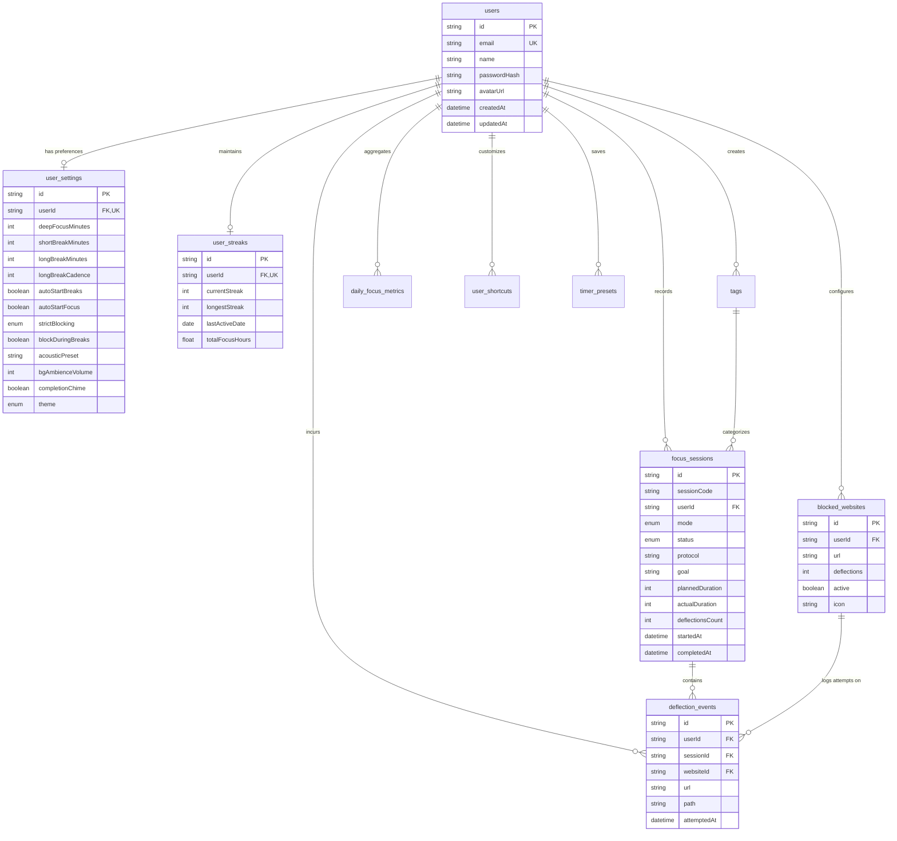

# Database Schema & Data Models

This document describes the PostgreSQL database architecture, Prisma ORM 7 models, entity relationships, and indexing strategies for **Do Not Disturb**.

---

## 1. Overview & Configuration

- **Database Engine**: PostgreSQL 14+
- **ORM**: Prisma ORM 7
- **Driver Adapter**: `@prisma/adapter-pg`
- **Client Output**: `lib/generated/prisma`
- **Schema File**: `prisma/schema.prisma`

---

## 2. Entity-Relationship Diagram (ERD)



---

## 3. Enums

### 3.1 `SessionMode`
Defines the timer category:
- `FOCUS`: Dedicated work interval (default: 25 minutes).
- `SHORT_BREAK`: Quick restorative pause (default: 5 minutes).
- `LONG_BREAK`: Extended rest interval after completing a cycle of focus sessions (default: 15 minutes).

### 3.2 `SessionStatus`
Represents the current lifecycle status of a session:
- `RUNNING`: Timer actively decrementing.
- `PAUSED`: Timer suspended by the user.
- `COMPLETED`: Planned duration reached successfully.
- `STOPPED`: Manually terminated before time elapsed.
- `CANCELLED`: Abandoned session.

### 3.3 `BlockingBehavior`
Controls extension blocking enforcement policy:
- `STRICT`: Blocking rules remain active even when the timer is paused.
- `SUSPEND`: Blocking rules are temporarily suspended while the timer is in a paused state.

### 3.4 `ThemePreference`
UI appearance preference:
- `LIGHT`: Serene bright palette.
- `DARK`: Low-light focused theme.
- `SYSTEM`: Matches the user operating system preference.

---

## 4. Model Specifications

### 4.1 `User` (`users`)
Stores core user identity and serves as the anchor for all personalized data.

| Column | Type | Constraints | Description |
| :--- | :--- | :--- | :--- |
| `id` | String | PK, `@default(cuid())` | Unique user identifier. |
| `email` | String | Unique, Nullable | Account email address. |
| `name` | String | Nullable | User display name. |
| `passwordHash` | String | Nullable | `scrypt` salt and hash (`salt:key`). |
| `avatarUrl` | String | Nullable | Profile image URL. |
| `createdAt` | DateTime | `@default(now())` | Account registration date. |
| `updatedAt` | DateTime | `@updatedAt` | Last profile update. |

---

### 4.2 `UserSettings` (`user_settings`)
One-to-one user configuration for timer intervals, audio presets, and blocking policies.

| Column | Type | Default | Description |
| :--- | :--- | :--- | :--- |
| `id` | String | PK (`cuid`) | Primary key. |
| `userId` | String | FK, Unique, Cascade | Reference to `User.id`. |
| `deepFocusMinutes`| Int | `25` | Focus session length in minutes. |
| `shortBreakMinutes`| Int | `5` | Short break duration. |
| `longBreakMinutes` | Int | `15` | Long break duration. |
| `longBreakCadence` | Int | `4` | Focus sessions before a long break. |
| `autoStartBreaks` | Boolean| `true` | Automatically starts breaks when focus ends. |
| `autoStartFocus` | Boolean| `false` | Automatically starts next focus block. |
| `strictBlocking` | Enum | `STRICT` | Strictness policy during paused states. |
| `blockDuringBreaks`| Boolean| `false` | Enforce domain blocking during breaks. |
| `acousticPreset` | String | `"rain"` | Default ambient sound ("rain", "binaural", "space"). |
| `bgAmbienceVolume`| Int | `65` | Ambience volume level (0–100%). |
| `completionChime` | Boolean| `true` | Play chime sound upon session completion. |
| `theme` | Enum | `SYSTEM` | Visual theme mode. |

---

### 4.3 `FocusSession` (`focus_sessions`)
Individual records of focused work sessions and completed breaks.

| Column | Type | Constraints | Description |
| :--- | :--- | :--- | :--- |
| `id` | String | PK (`cuid`) | Session ID. |
| `sessionCode` | String | Nullable | Formatted code for display (e.g. `#SESS-4029`). |
| `userId` | String | FK, SetNull | Associated user. |
| `mode` | `SessionMode` | Default `FOCUS` | Mode of the session. |
| `status` | `SessionStatus`| Default `COMPLETED` | Outcome of the session. |
| `goal` | String | Nullable | Primary objective for the session. |
| `plannedDuration` | Int | Required | Target duration in seconds. |
| `actualDuration` | Int | Required | Actual focused duration in seconds. |
| `deflectionsCount`| Int | Default `0` | Number of deflected distraction attempts. |
| `startedAt` | DateTime | Default `now()` | Start timestamp. |
| `completedAt` | DateTime | Nullable | Completion timestamp. |

---

### 4.4 `BlockedWebsite` (`blocked_websites`)
Target domains registered for distraction blocking.

| Column | Type | Default | Description |
| :--- | :--- | :--- | :--- |
| `id` | String | PK (`cuid`) | Unique identifier. |
| `userId` | String | FK, Cascade | Associated user ID. |
| `url` | String | Required | Domain name (e.g., `youtube.com`). |
| `deflections` | Int | `0` | Cumulative deflection tally. |
| `active` | Boolean | `true` | Blocking enabled/disabled toggle. |
| `icon` | String | `"link"` | UI category icon name. |

---

### 4.5 `DeflectionEvent` (`deflection_events`)
Granular logs of each deflected navigation attempt during an active focus block.

| Column | Type | Constraints | Description |
| :--- | :--- | :--- | :--- |
| `id` | String | PK (`cuid`) | Event ID. |
| `userId` | String | FK, Cascade | User encountering the block. |
| `sessionId` | String | FK, SetNull | Active session when event occurred. |
| `websiteId` | String | FK, SetNull | Blocked domain reference. |
| `url` | String | Required | Domain attempted. |
| `path` | String | Nullable | Subpath attempted (e.g., `/shorts`). |
| `attemptedAt` | DateTime | Default `now()` | Event timestamp. |

---

### 4.6 `DailyFocusMetric` (`daily_focus_metrics`)
Pre-aggregated rollups for analytics charts and daily productivity reports.

| Column | Type | Default | Description |
| :--- | :--- | :--- | :--- |
| `id` | String | PK (`cuid`) | Primary key. |
| `userId` | String | FK, Cascade | Associated user ID. |
| `date` | DateTime (`@db.Date`)| Required | Calendar day. |
| `totalFocusSeconds`| Int | `0` | Cumulative seconds focused on that day. |
| `completedSessions`| Int | `0` | Completed focus intervals. |
| `interruptedSessions`| Int | `0` | Abandoned or cancelled sessions. |
| `totalDeflections` | Int | `0` | Blocked distractions count on that date. |

---

### 4.7 `UserShortcut` (`user_shortcuts`)
Custom keybindings mapped to application actions (e.g. `["Space"]` for toggle timer).

| Column | Type | Constraints | Description |
| :--- | :--- | :--- | :--- |
| `id` | String | PK (`cuid`) | Primary key. |
| `userId` | String | FK, Cascade | Associated user ID. |
| `actionType` | String | Required | Action identifier (e.g. `toggleTimer`). |
| `keys` | String[] | Required | Key array (e.g. `["Ctrl", "Alt", "F"]`). |

---

### 4.8 `UserStreak` (`user_streaks`)
Streak tracking and aggregate focus hours.

| Column | Type | Default | Description |
| :--- | :--- | :--- | :--- |
| `id` | String | PK (`cuid`) | Primary key. |
| `userId` | String | FK, Unique, Cascade | Associated user. |
| `currentStreak` | Int | `0` | Consecutive active focus days. |
| `longestStreak` | Int | `0` | Best streak achieved. |
| `lastActiveDate` | DateTime (`@db.Date`)| Nullable | Most recent active day. |
| `totalFocusHours`| Float | `0.0` | Lifetime focus hours. |

---

## 5. Database Commands

```bash
# Generate Prisma Client code
pnpm prisma:generate

# Apply migrations in development
pnpm prisma:migrate

# Deploy migrations in production
pnpm prisma:deploy

# Open Prisma Studio web inspector
pnpm prisma:studio
```
