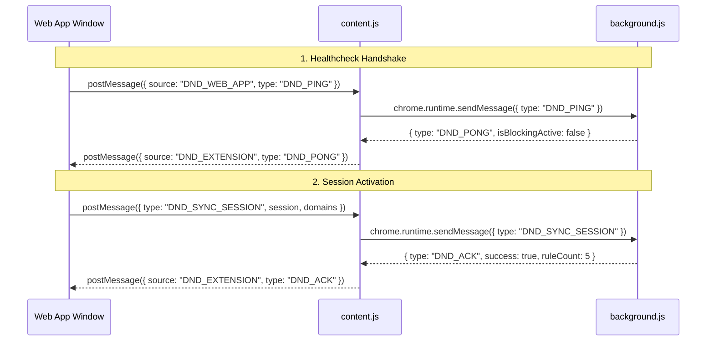

# Companion Browser Extension Guide

The **Do Not Disturb — Focus Guard** browser extension is a Chromium Manifest V3 companion extension that enforces real, browser-level website blocking during focus sessions.

---

## 1. Extension Architecture Overview

Web pages running in sandbox browser tabs cannot alter network requests or block external websites on their own. The companion extension provides this capability by running as an elevated browser component with privileged APIs:

```
extension/
├── manifest.json       # Manifest V3 configuration & permission grants
├── background.js       # Background Service Worker (DNR rules & alarms)
├── content.js          # Web-page content script bridge
├── popup.html          # Toolbar quick-status popup markup
├── popup.js            # Toolbar quick-status logic & quick toggles
├── blocked.html        # Bundled offline fallback deflection page
└── icons/              # Extension icons (16px, 48px, 128px)
```

---

## 2. Manifest V3 Permissions & APIs

The extension requests only the minimum required permissions to perform its focus guarding duties:

| Permission | Purpose |
| :--- | :--- |
| `declarativeNetRequest` | Enables high-performance, privacy-preserving HTTP request redirection without inspecting request payloads or browsing history. |
| `storage` | Persists session configuration, active blocked domains, and deflection counts across browser sessions. |
| `alarms` | Schedules background alarms (`chrome.alarms`) that guarantee rules are automatically lifted when a session expires, even if the web app tab is closed. |
| `host_permissions: ["<all_urls>"]` | Required by Chromium to allow dynamic redirection of arbitrary user-defined blocked URLs (e.g., `reddit.com`, `x.com`, `youtube.com`). |

---

## 3. Core Mechanisms

### 3.1 Declarative Net Request Rules Engine

When a focus session starts in the web app, `background.js` generates dynamic DNR rules:

```javascript
// Example dynamic rule structure created by background.js
{
  id: 1001,
  priority: 1,
  action: {
    type: "redirect",
    redirect: {
      url: "http://localhost:3000/blocked?blocked=youtube.com"
    }
  },
  condition: {
    urlFilter: "||youtube.com^",
    resourceTypes: ["main_frame"]
  }
}
```

- **`||<domain>^` pattern**: Ensures that requests to `youtube.com`, `www.youtube.com`, `m.youtube.com`, and deep paths like `youtube.com/shorts` are all captured and deflected.
- **`main_frame` filter**: Restricts redirection exclusively to top-level tab navigations. Embedded resources, third-party API calls, and background telemetry from other tabs are unaffected.
- **Rule ID Isolation**: Rules are numbered dynamically starting from `RULE_BASE_ID = 1000`. When a session completes or is stopped, `clearBlockingRules()` removes all registered IDs in a single atomic operation.

### 3.2 Offline Fallback Deflection

If the local web server is not running or the network is offline, the extension falls back to its bundled `blocked.html` file packaged within the extension assets (`chrome.runtime.getURL("blocked.html")`), ensuring the user is never left with a broken connection page.

### 3.3 Autonomous Expiry via Alarms

If the user closes the Do Not Disturb web dashboard tab during an active session:
1. The background service worker maintains the session end timestamp (`endsAt`) in `chrome.storage.local`.
2. A `chrome.alarms` instance is scheduled:
   ```javascript
   chrome.alarms.create("dnd_session_expiry", { delayInMinutes });
   ```
3. When the alarm fires, the background worker automatically cleans up all dynamic DNR rules and updates the badge icon to show the session has elapsed.

---

## 4. Web Application Bridge Protocol

The extension communicates with the Do Not Disturb web application via a bidirectional bridge implemented in `content.js`:



### Supported Protocol Messages

- `DND_PING` / `DND_PONG`: Periodic heartbeat ensuring the extension is installed and responsive.
- `DND_GET_STATUS` / `DND_STATUS_RESPONSE`: Queries active session state, rule count, and blocked domains.
- `DND_SYNC_SESSION`: Transmits updated timer countdown, mode, and target domain array.
- `DND_STOP_SESSION`: Immediately clears all dynamic rules and terminates blocking.
- `DND_UPDATE_BLOCKLIST`: Updates domain rules without altering the running timer.

---

## 5. Step-by-Step Installation Guide

The extension is compatible with all Chromium-based browsers, including **Google Chrome**, **Brave**, **Microsoft Edge**, **Vivaldi**, and **Arc**.

### Standard Installation (Unpacked Developer Mode)

1. Open your browser's extension management page:
   - **Chrome / Brave**: Navigate to `chrome://extensions`
   - **Microsoft Edge**: Navigate to `edge://extensions`
2. Enable **Developer mode** using the toggle switch located in the top-right corner.
3. Click the **Load unpacked** button in the top-left toolbar.
4. Browse to and select the `extension/` folder inside your project directory:
   ```
   c:\Users\USER\Documents\Projects\[frontend]\Personal\do-not-disturb\extension
   ```
5. Confirm that **Do Not Disturb — Focus Guard** appears in your extension list.
6. Open or refresh the Do Not Disturb web app at `http://localhost:3000/blocklist`.
7. The status badge will update to display: **"Browser Extension Connected"**.

---

## 6. Testing & Verifying Blocking

To test website deflection:

1. Navigate to `http://localhost:3000/blocklist`.
2. Verify that `youtube.com` (or your chosen site) has the active toggle enabled.
3. Return to the home dashboard (`http://localhost:3000/`) and click **Start Focus**.
4. Open a new browser tab and navigate to `https://www.youtube.com`.
5. You should be instantly deflected to the `/blocked` sanctuary page.
6. Click **Pause** or **Stop** on the timer in the web app.
7. Reload `youtube.com` — normal access is immediately restored.

---

## 7. Packaging & Distribution

To prepare the extension for distribution or download via the web app (`/api/extension/download`):

1. Compress the contents of the `extension/` folder into a ZIP file.
2. Place the resulting archive into `public/do-not-disturb-extension.zip`.
3. Users can click the **Download Extension** button on the `/blocklist` or settings page to obtain the pre-packaged archive directly.

---

## 8. Extension Debugging Tips

- **Service Worker Console**: On `chrome://extensions`, click the **"service worker"** link on the Do Not Disturb card to inspect background logs, dynamic rules, and alarms.
- **Reloading Changes**: After modifying any file in `extension/`, click the circular **Reload** icon on the extension card in `chrome://extensions`.
- **Inspecting Rules**: You can run `chrome.declarativeNetRequest.getDynamicRules()` directly in the service worker console to verify currently active redirection rules.
