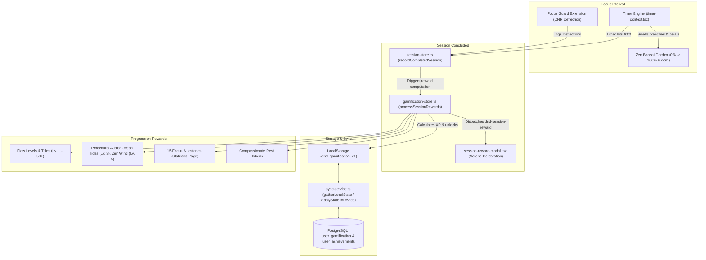

# Gamification, Flow Progression & Zen Sanctuary

This document details the architectural design, behavioral mechanics, data models, and user experience of the **Gamification and Flow Progression System** in **Do Not Disturb**.

---

## 1. Core Philosophy: Intrinsic, Calm Gamification

Most productivity tools implement aggressive gamification characterized by:
- Intrusive notifications and popups that disrupt deep work.
- Rigid streak systems that induce guilt and anxiety (the "Duolingo effect"), causing users to abandon the app if a single day is missed due to illness or travel.
- Cluttered interfaces overloaded with flashing arcade badges, coins, and pill tags.

**Do Not Disturb** takes the opposite approach: **Calm, Intrinsic Gamification**.
1. **Focus First**: The gamification never interrupts an active focus session. Rewards, celebrations, and level updates occur strictly *after* a session is completed.
2. **Positive Empowerment from Distractions**: Instead of shaming users for opening blocked websites, the companion extension intercepts each attempt as a **"Zen Shield"** or deflection pulse, rewarding users with resilience XP for staying in flow.
3. **Compassionate Habit Streaks**: Users earn **Mindful Rest Tokens** that automatically safeguard streaks during intentional rest days, promoting sustainable long-term habits without burnout.
4. **Organic Visual Growth**: Progress is visualized through a blossoming **Zen Bonsai Garden** and serene procedural ambient audio stems that unlock as users progress.
5. **Clean & Human-Friendly UI**: Avoids loud pill badges or noisy game tags in favor of clear, readable, and serene typography.

---

## 2. System Architecture & Flow



---

## 3. Experience Points (XP) & Progression Engine

### 3.1 XP Earning Rules

Every completed focus interval awards Flow XP based on four key factors:

| Trigger | XP Awarded | Description |
| :--- | :--- | :--- |
| **Focused Time** | $+10\text{ XP}$ per minute | Granted for every elapsed minute of completed deep work. |
| **Target Reached** | $+50\text{ XP}$ bonus | Awarded for completing a full planned session without early cancellation. |
| **Serene Silence** | $+35\text{ XP}$ bonus | Granted when a session completes with zero deflected distraction attempts. |
| **Zen Shield Pulses** | $+15\text{ XP}$ per deflection | Rewards resilience each time the browser extension blocks an impulsive tab attempt. |
| **Habit Momentum** | $+5\text{ to } 50\text{ XP}$ bonus | Scaled reward for active daily streak cadences ($\ge 3$ consecutive days). |
| **Milestone Unlocks** | $+50\text{ to } 1,200\text{ XP}$ | One-time bonuses upon reaching milestones and achievements. |

### 3.2 Level Curve & Flow Titles

Level advancement uses a smooth polynomial curve:

$$\text{XP Required for Level } N = 300 + 160 \times (N - 1)^{1.25}$$

Users advance through peaceful, aspirational titles:

| Level Tier | Title | Theme |
| :--- | :--- | :--- |
| **Level 1** | Novice Focus | Starting the journey |
| **Level 2** | Calm Observer | Developing mindful awareness |
| **Level 3** | Mindful Pacer | Unlocks **Ocean Tides** soundscape |
| **Level 5** | Deliberate Thinker | Unlocks **Zen Wind** soundscape |
| **Level 7** | Flow Seeker | Deepening immersion |
| **Level 10** | Deep Diver | Sustained focus mastery |
| **Level 15** | Flow Artisan | Craftsman of deep work |
| **Level 20** | Shield Sovereign | Distraction immunity |
| **Level 30** | Zen Master | Mastery of attention |
| **Level 40** | Grandmaster of Flow | Effortless concentration |
| **Level 50+** | Enlightened Ascendant | Highest tier of flow |

---

## 4. Compassionate Habit Streaks & Rest Tokens

Traditional productivity apps punish users with a full reset to Day 0 if they take a single day off. In **Do Not Disturb**, streaks promote healthy balance:

- **Starting Allowance**: New users receive **2 Rest Tokens**.
- **Accrual Rate**: Users earn **1 additional Rest Token** for every **5 consecutive focus days** (capped at 5 tokens).
- **Automatic Protection**: If a user misses a day (e.g. weekend or travel), a Rest Token is automatically applied to protect the streak.
- **Manual Intentional Rest**: Users can also activate a Rest Day via the navigation dropdown card.

---

## 5. Visual Zen Sanctuary: Procedural Bonsai Tree

Users can switch between the standard countdown arc and the **Zen Garden** directly on the dashboard (`app/page.tsx`):

```tsx
<ZenGardenWidget size={240} />
```

As the countdown progresses from 0% to 100%, the procedural SVG bonsai blossoms organically:

1. **Stage 1 (0% - 25%)**: Soil and primary gnarled amber trunk sprout upwards.
2. **Stage 2 (25% - 50%)**: Lateral branches branch out left and right.
3. **Stage 3 (50% - 75%)**: Serene pine canopy clouds develop in layered emerald shades.
4. **Stage 4 (75% - 98%)**: Delicate sakura blossom buds bloom across the branches.
5. **Stage 5 (100% Bloom)**: The tree fully flowers with glowing petals and a rotating circular Zen shield aura.

---

## 6. Procedural Audio Unlocks (Web Audio API)

Milestone levels unlock new offline procedural soundscapes synthesized directly via the Web Audio API without requiring external audio downloads:

### 6.1 Standard Presets (Available at Level 1)
- **Gentle Rain (`rain`)**: Pink noise filtered through dynamic modulation envelopes mimicking rainfall.
- **Focus Beats (`binaural`)**: 40 Hz stereo-detuned sine waves stimulating gamma entrainment.
- **Deep Space (`space`)**: Low-frequency resonant drone masking environmental noise.

### 6.2 Level-Unlocked Presets
- **Ocean Tides (`waves`) — Unlocks at Level 3:**
  - Uses dual-layer Brownian and pink noise routed through a resonant lowpass filter modulated by a 0.09 Hz oscillator (~11-second rolling wave cycle), recreating the rhythmic surge of ocean waves on sand.
- **Zen Wind (`forest`) — Unlocks at Level 5:**
  - Synthesizes an ambient canopy breeze using resonant bandpass-filtered noise (540 Hz) paired with a subtle harmonic overtone (880 Hz whistle) modulated by a gentle 0.14 Hz wind gust LFO.

---

## 7. Milestones & Achievements Catalog

The platform tracks 28 focus milestones across 4 distinct categories:

| ID | Title | Category | Requirement | Reward |
| :--- | :--- | :--- | :--- | :--- |
| `first_spark` | **First Spark** | Focus | Complete your first focus session | $+50\text{ XP}$ |
| `zen_intent` | **Clear Intent** | Focus | Complete a session with focus goal/intent set | $+100\text{ XP}$ |
| `steady_cadence` | **Steady Cadence** | Focus | Successfully complete 10 focus sessions | $+150\text{ XP}$ |
| `deep_diver` | **Deep Diver** | Focus | Complete a 45+ min focus session | $+150\text{ XP}$ |
| `endurance_master`| **Flow Marathon** | Focus | Complete an unbroken 60+ min focus sprint | $+250\text{ XP}$ |
| `iron_will` | **Iron Will** | Focus | Complete a session with 0 pauses and 0 deflections | $+200\text{ XP}$ |
| `daily_trio` | **Daily Hat Trick** | Focus | Complete 3 focus sessions in a single day | $+175\text{ XP}$ |
| `high_output_five`| **Fivefold Focus** | Focus | Complete 5 focus sessions in a single calendar day | $+350\text{ XP}$ |
| `quad_sprint` | **Ultradian Flow** | Focus | Complete 4 consecutive focus cycles | $+300\text{ XP}$ |
| `sprint_veteran` | **Sprint Veteran** | Focus | Successfully complete 25 focus sessions | $+350\text{ XP}$ |
| `century_sprint` | **Century Sprint** | Focus | Master 100 completed deep focus sessions | $+800\text{ XP}$ |
| `shield_initiate`| **Shield Activated** | Deflection | Deflect your first distraction with extension | $+50\text{ XP}$ |
| `shield_sentinel`| **Sentinel Shield** | Deflection | Repel 10 distracting impulses | $+100\text{ XP}$ |
| `digital_fortress`| **Digital Fortress** | Deflection | Deflect 25 distraction attempts | $+200\text{ XP}$ |
| `impenetrable_sanctuary`| **Impenetrable Focus** | Deflection | Repel 50 distraction attempts across journey | $+350\text{ XP}$ |
| `zen_aegis` | **Zen Aegis** | Deflection | Deflect 100 distraction attempts | $+500\text{ XP}$ |
| `unshakable_focus`| **Unshakable Will** | Deflection | Repel 3+ distractions in one session | $+250\text{ XP}$ |
| `serene_clarity` | **Serene Sanctuary** | Deflection | Repel 5+ distractions in one session | $+350\text{ XP}$ |
| `early_bird` | **Dawn Chorus** | Habits | Complete a session before 8:00 AM | $+75\text{ XP}$ |
| `noon_oasis` | **Noon Oasis** | Habits | Complete a focus session between 12:00 PM and 2:00 PM | $+75\text{ XP}$ |
| `night_owl` | **Midnight Lantern** | Habits | Complete a session after 10:00 PM | $+75\text{ XP}$ |
| `weekend_warrior`| **Mindful Weekend** | Habits | Complete a session on Saturday or Sunday | $+100\text{ XP}$ |
| `streak_3` | **Triple Rhythm** | Habits | Maintain a 3-day focus habit | $+100\text{ XP}$ |
| `streak_7` | **Unshakeable Habit** | Habits | Maintain a 7-day focus streak | $+300\text{ XP}$ |
| `streak_14` | **Fortnight Cadence** | Habits | Maintain a 14-day continuous focus habit streak | $+500\text{ XP}$ |
| `streak_30` | **Zen Practitioner** | Habits | Maintain a 30-day focus streak | $+1,000\text{ XP}$ |
| `hour_power` | **Hour of Power** | Mastery | Accumulate 1 hour of total focus | $+50\text{ XP}$ |
| `flow_apprentice`| **Flow Apprentice** | Mastery | Accumulate 5 hours of total deep focus | $+125\text{ XP}$ |
| `flow_adept` | **Flow Adept** | Mastery | Accumulate 10 hours of total deep focus | $+250\text{ XP}$ |
| `flow_virtuoso` | **Flow Virtuoso** | Mastery | Accumulate 50 hours of total deep focus | $+600\text{ XP}$ |
| `centurion` | **Flow Centurion** | Mastery | Accumulate 100 hours of total focus | $+1,200\text{ XP}$ |
| `level_5_ascendant`| **Rising Practitioner** | Mastery | Ascend to Flow Level 5 | $+200\text{ XP}$ |
| `level_10_ascendant`| **Deep Work Architect** | Mastery | Ascend to Flow Level 10 | $+400\text{ XP}$ |

All milestones are browsable with live progress bars at `/statistics#achievements`.

---

## 8. Data Models & Synchronization

### 8.1 Prisma Database Schema

```prisma
model UserGamification {
  id                   String   @id @default(cuid())
  userId               String   @unique
  user                 User     @relation(fields: [userId], references: [id], onDelete: Cascade)

  level                Int      @default(1)
  currentXp            Int      @default(0)
  nextLevelXp          Int      @default(300)
  totalXp              Int      @default(0)
  streakTokens         Int      @default(2)
  totalShieldsRepelled Int      @default(0)
  lastActiveDate       String?

  createdAt            DateTime @default(now())
  updatedAt            DateTime @updatedAt

  @@map("user_gamification")
}

model UserAchievement {
  id            String   @id @default(cuid())
  userId        String
  user          User     @relation(fields: [userId], references: [id], onDelete: Cascade)

  achievementId String
  unlockedAt    DateTime @default(now())

  createdAt     DateTime @default(now())
  updatedAt     DateTime @updatedAt

  @@unique([userId, achievementId])
  @@index([userId])
  @@map("user_achievements")
}
```

### 8.2 Local-First Storage, Events & Cloud Synchronization

- **Local Storage Key**: `dnd_gamification_v1`
- **Reactivity Events**:
  - `dnd-gamification-updated`: Fired on level up, XP gain, or rest token consumption across all open tabs.
  - `dnd-session-reward`: Fired when a focus sprint finishes to open the serene celebration dialog.
- **Bi-Directional Cloud Sync (`/api/sync`)**:
  - **Payload Structure**: Transmitted under the `gamification` field in `SyncPayload` (`lib/sync/sync-types.ts`).
  - **Reconciliation Engine**: Merged via `mergeLocalWithCloud` in `lib/sync/sync-service.ts` and upserted in `/api/sync` (both GET and POST), `/api/auth/login`, and `/api/auth/register`. If a user focuses offline or across multiple machines, the system applies maximum-progress resolution (`max(local.totalXp, cloud.totalXp)`, `max(local.level, cloud.level)`), takes the union of all unlocked achievement badges, and preserves the highest count of Rest Day tokens and shielded deflections.
