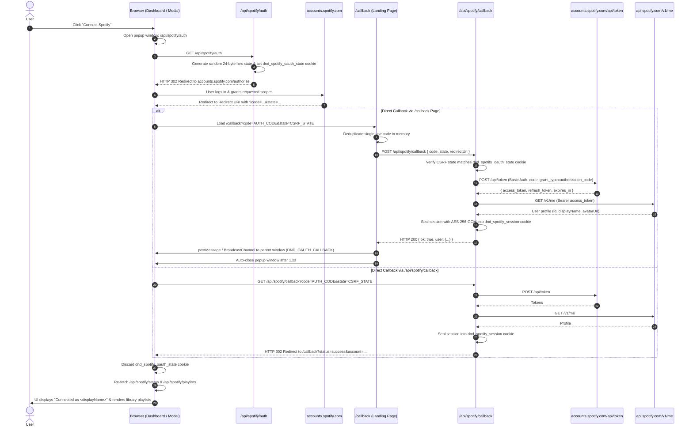
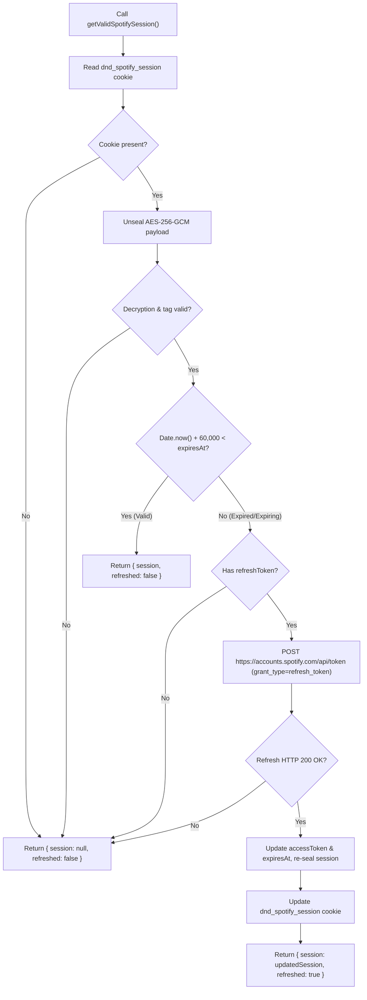

# Spotify Integration Flow & Architecture Guide

This document provides a comprehensive technical overview and operational guide for the **Spotify Integration** in **Do Not Disturb**, detailing the OAuth 2.0 authorization pipeline, encrypted cookie-based session management, Spotify IFrame Embed Controller lifecycle, audio coordinator event bus, timer synchronization, and troubleshooting procedures.

---

## 1. Overview & Core Principles

Do Not Disturb integrates Spotify alongside its procedural Web Audio ambient soundscape engine, allowing users to soundtrack deep focus sessions with either curated focus playlists, personal library playlists, or custom Spotify URLs/URIs.

```
┌─────────────────────────────────────────────────────────────────────────────┐
│                       Do Not Disturb Focus Sanctuary                         │
│                                                                             │
│   ┌───────────────────────────┐         ┌───────────────────────────────┐   │
│   │   Procedural Web Audio    │   OR    │     Spotify Focus Player      │   │
│   │   (Rain, Binaural, Space) │  BOTH   │    (Curated, Library, Custom) │   │
│   └───────────────────────────┘         └───────────────────────────────┘   │
│                                 ▲                                           │
│                                 │                                           │
│                    ┌─────────────────────────┐                              │
│                    │    Audio Coordinator    │                              │
│                    │   (lib/sound/audio-     │                              │
│                    │    coordinator.ts)      │                              │
│                    └─────────────────────────┘                              │
│                                 ▲                                           │
│                                 │                                           │
│         ┌───────────────────────────────────────────────┐                   │
│         │         Timer Engine (TimerContext)           │                   │
│         │   Start Focus ──► Play Audio                  │                   │
│         │   Break / Pause ──► Pause Audio               │                   │
│         │   PiP Mini Window ──► Synchronized Playback   │                   │
│         └───────────────────────────────────────────────┘                   │
└─────────────────────────────────────────────────────────────────────────────┘
```

The integration adheres to three architectural tenets:

1. **Stateless & Database-Decoupled**: Spotify access and refresh tokens are **never written to the PostgreSQL database**. Tokens are stored securely on the client via an HTTP-only, AES-256-GCM encrypted session cookie. Guests and signed-in users enjoy identical Spotify functionality without database migrations or schema pollution.
2. **Dual-Mode OAuth Code Exchange**: The backend supports both standard 302 redirect loops (`GET /api/spotify/callback`) and asynchronous frontend-mediated code exchanges (`POST /api/spotify/callback` via `app/callback/page.tsx`), providing resilience against popup blockers, cross-window messaging restrictions, and redirect URI discrepancies.
3. **Session Continuity & Track Memory**: Pausing the Pomodoro timer or switching modes preserves the currently loaded track URI (`lastPlayedTrackUri`). Resuming a session resumes playback from where the user left off rather than resetting to the first track of the playlist.

---

## 2. High-Level Architecture & Component Map

The Spotify integration consists of server-side API handlers, encryption utilities, client-side state stores, the Spotify Web Embed Controller, and the cross-window audio coordinator:

```mermaid
flowchart TD
    subgraph Client ["Client Browser Layer"]
        subgraph UI ["User Interface"]
            Dashboard["Main Dashboard (app/page.tsx)"]
            Widget["Draggable Spotify Widget (components/spotify/draggable-spotify-widget.tsx)"]
            Player["Spotify Focus Player (components/spotify/spotify-focus-player.tsx)"]
            MiniPiP["Mini PiP Window (components/mini-timer-window.tsx)"]
            CallbackPage["OAuth Callback Landing (app/callback/page.tsx)"]
        end

        subgraph ClientState ["Client State & Messaging"]
            SpotifyStore["Spotify Store & Shared Playlist Cache (lib/spotify/spotify-store.ts)"]
            AudioCoord["Audio Coordinator (lib/sound/audio-coordinator.ts)"]
            TrackStore["Current Track Store (lib/sound/current-track-store.ts)"]
            BChannel[("BroadcastChannel: dnd-spotify-channel & dnd-spotify-command-channel")]
        end

        subgraph Embed ["Spotify Playback Engines (Two-Way Connect + Embed Fallback)"]
            WebPlaybackSDK["Spotify Web Playback SDK (sdk.scdn.co/spotify-player.js)"]
            ConnectDevice["Spotify Connect Device ('Do Not Disturb Focus')"]
            IFrameSDK["Spotify IFrame API (open.spotify.com/embed/iframe-api/v1)"]
            EmbedController["EmbedController Fallback Instance"]
        end
    end

    subgraph Server ["Next.js Server Layer (App Router)"]
        AuthRoute["GET /api/spotify/auth"]
        CallbackRoute["GET & POST /api/spotify/callback"]
        StatusRoute["GET & DELETE /api/spotify/status"]
        PlaylistsRoute["GET /api/spotify/playlists"]
        PlayerRoute["GET & POST /api/spotify/player"]
        CurrentTrackRoute["GET /api/spotify/current-track"]
        ServerLib["Spotify Server Engine (lib/spotify/spotify-server.ts)"]
    end

    subgraph SpotifyAPI ["Spotify Cloud Services"]
        SpotifyAuth["Accounts Service (accounts.spotify.com)"]
        SpotifyWebAPI["Spotify Web API & Connect (api.spotify.com/v1)"]
        SpotifyEmbedSSR["Spotify Embed SSR & oEmbed (open.spotify.com)"]
    end

    %% Client UI to State
    Widget --> Player
    Widget --> SpotifyStore
    Widget --> AudioCoord
    Widget --> TrackStore
    Player --> SpotifyStore
    Player --> AudioCoord
    Player --> TrackStore
    MiniPiP --> AudioCoord
    MiniPiP --> TrackStore
    CallbackPage --> BChannel

    %% Client State & Cross-tab
    SpotifyStore <--> BChannel
    AudioCoord <--> BChannel

    %% Playback SDKs
    Player --> WebPlaybackSDK
    WebPlaybackSDK --> ConnectDevice
    ConnectDevice -- "player_state_changed / ready" --> Player
    Player --> IFrameSDK
    IFrameSDK --> EmbedController
    EmbedController -- "playback_update / ready" --> Player

    %% Client to Server API
    Dashboard -- "Initiate OAuth" --> AuthRoute
    CallbackPage -- "POST code exchange" --> CallbackRoute
    Player -- "GET status & playlists" --> PlaylistsRoute
    Player -- "GET/POST Spotify Connect sync" --> PlayerRoute
    Player -- "GET now-playing track info" --> CurrentTrackRoute
    StatusRoute <--> ServerLib
    PlaylistsRoute <--> ServerLib
    PlayerRoute <--> ServerLib
    CurrentTrackRoute <--> ServerLib

    %% Server to Spotify Cloud
    AuthRoute -- "Redirect 302" --> SpotifyAuth
    CallbackRoute -- "Authorization Code Exchange" --> SpotifyAuth
    ServerLib -- "Refresh Expired Access Token" --> SpotifyAuth
    PlaylistsRoute -- "GET /me/playlists & /users/{id}/playlists" --> SpotifyWebAPI
    PlaylistsRoute -- "Fallback playlist & tracks SSR" --> SpotifyEmbedSSR
    PlayerRoute -- "GET/PUT/POST /me/player/*" --> SpotifyWebAPI
    CurrentTrackRoute -- "GET /me/player/currently-playing" --> SpotifyWebAPI
    CurrentTrackRoute -- "Fallback oEmbed" --> SpotifyEmbedSSR
```



---

## 3. End-to-End OAuth 2.0 Authorization Flow

Do Not Disturb implements the **OAuth 2.0 Authorization Code Grant** flow with cryptographically random CSRF verification:

### 3.1 OAuth Scopes Requested

The integration requests permissions for playlist retrieval, Web Playback SDK streaming, and two-way Spotify Connect remote control:

| Scope | Purpose |
| :--- | :--- |
| `user-read-email` | Identifies user email for account verification. |
| `user-read-private` | Retrieves user profile, avatar, and subscription tier (`premium` vs `free`). |
| `playlist-read-private` | Fetches private playlists created or saved by the user. |
| `playlist-read-collaborative` | Fetches collaborative playlists in the user's library. |
| `user-read-playback-state` | Reads active Spotify Connect player devices and real-time playback state. |
| `user-modify-playback-state` | Controls playback (`play`, `pause`, `next`, `previous`, device `transfer`) across the website and the user's Spotify app. |
| `user-read-currently-playing` | Reads the user's currently playing track metadata. |
| `streaming` | Registers the browser tab as a live Spotify Connect device (`"Do Not Disturb Focus"`) via the Spotify Web Playback SDK. |

---

### 3.2 Authorization Sequence Diagram



---

## 4. Cryptographic Session Storage & Token Refresh

### 4.1 AES-256-GCM Session Sealing

Rather than persisting tokens in plain text in cookies or `localStorage`, `lib/spotify/spotify-server.ts` stores the long-lived `refreshToken` and session metadata in an HTTP-only, AES-256-GCM encrypted cookie (`dnd_spotify_session`). The short-lived `accessToken` is kept inside the encrypted HTTP-only cookie and only provisioned in-memory on demand via `GET /api/spotify/player?token=1` when initializing the official Spotify Web Playback SDK (`window.Spotify.Player`) for eligible Spotify Premium streaming sessions:

```typescript
// Payload Structure
export interface StoredSpotifySession {
  accessToken: string;
  refreshToken: string;
  expiresAt: number; // Unix timestamp in milliseconds
  user?: {
    id: string;
    displayName: string;
    email?: string;
    avatarUrl?: string | null;
    product?: string; // "premium" | "free"
    profileUrl?: string;
  };
}
```

#### Encryption Specification:
- **Algorithm**: `aes-256-gcm`
- **Encryption Key**: 32-byte SHA-256 digest of `process.env.AUTH_SECRET` (or `process.env.BETTER_AUTH_SECRET`).
- **Initialization Vector (IV)**: 12 cryptographically random bytes generated via `crypto.randomBytes(12)` per encryption operation.
- **Authentication Tag**: 16-byte GCM authentication tag verifying ciphertext integrity and authenticity.
- **Serialized Cookie Format**:
  $$\text{Cookie Value} = \text{base64url}(\text{IV}) \,.\, \text{base64url}(\text{AuthTag}) \,.\, \text{base64url}(\text{Ciphertext})$$

#### Cookie Flags:
```typescript
cookieStore.set("dnd_spotify_session", sealed, {
  httpOnly: true,
  secure: process.env.NODE_ENV === "production",
  sameSite: "lax",
  path: "/",
  maxAge: 60 * 60 * 24 * 60, // 60 days
});
```

---

### 4.2 Transparent Silent Token Refresh

Spotify access tokens expire after 1 hour (`expires_in: 3600`). Whenever any server endpoint needs the user's access token, it calls `getValidSpotifySession()`:



The 60-second safety buffer ensures tokens never expire mid-request.

---

## 5. Client Integration: Two-Way Spotify Connect, Web Playback SDK & Embed Fallback

Spotify playback inside the web application combines the **Spotify Web Playback SDK** (`https://sdk.scdn.co/spotify-player.js`) + **Spotify Connect REST API** (`/api/spotify/player`) for real-time two-way synchronization with the user's native Spotify desktop/mobile app, backed by the **Spotify Official IFrame API** (`https://open.spotify.com/embed/iframe-api/v1`) as a universal fallback (`components/spotify/spotify-focus-player.tsx`), mounted persistently inside the global floating **Draggable Spotify Widget** (`components/spotify/draggable-spotify-widget.tsx`).

### 5.1 Two-Way Spotify App Synchronization (Spotify Connect + Web Playback SDK)

When a user connects their Spotify account:
1. **Browser as a Live Spotify Connect Device (`"Do Not Disturb Focus"`)**:
   - `SpotifyFocusPlayer` loads `https://sdk.scdn.co/spotify-player.js` and initializes `new window.Spotify.Player({ name: "Do Not Disturb Focus", getOAuthToken: ... })` using fresh access tokens from `GET /api/spotify/player?token=1`.
   - When the user plays a track or playlist from the website, their native Spotify mobile or desktop app immediately displays the currently playing song, album artwork, progress bar, and **`Listening on Do Not Disturb Focus`**.
2. **Bidirectional Song & Playback Control**:
   - **Spotify App → Website**: Skipping tracks, selecting a new song/playlist, or pausing from the Spotify mobile/desktop app triggers `player_state_changed` events on the Web Playback SDK and updates `GET /api/spotify/player` (polled every 4 seconds while the tab is visible). The website immediately updates `current-track-store.ts` (`setCurrentPlayingTrack`) and `spotify-store.ts` (`lastPlayedTrackUri`) across the floating widget, dashboard, and Picture-in-Picture mini-timer.
   - **Website → Spotify App**: Selecting any song/playlist or clicking Play/Pause/Next/Previous on the website routes through `POST /api/spotify/player`. When playing a track inside a playlist, `{ context_uri: selectedPlaylistUri, offset: { uri } }` is sent so skipping to the next song in the Spotify app continues seamlessly through that playlist.
3. **Device Handoff & Fallback**:
   - The floating widget displays the active Spotify Connect device (`Spotify App · <Device Name>`), a **`Play here`** button to transfer playback from a phone/desktop app into the browser tab, and an **`Open App ↗`** deep link.
   - If Spotify Connect is unavailable (e.g., guest users not signed in via OAuth, or Free tier accounts without an active remote Spotify app), playback automatically falls back to the built-in `EmbedController` iframe.

### 5.2 Persistent Global Widget & Player Initialization

Because `DraggableSpotifyWidget` is mounted in `app/layout.tsx`, the underlying `SpotifyFocusPlayer` instance stays alive across all route transitions (`/`, `/settings`, `/statistics`, `/connected-apps`) without unmounting:
- **Floating Draggable Button (`44px`)**: Positioned anywhere on the viewport (persisted to `localStorage` under `dnd_spotify_widget_pos`). Displays a live pulse indicator when Spotify is actively playing.
- **Compact Popover Controller (`290px`)**: Provides instant track/playlist search, a toggleable `Songs` vs `Playlists` browser (auto-switching to `Playlists` when connected), a manual playlist refresh (`↻`) button, drill-down track listings for both personal and curated playlists, inline transport controls (`prev`, `toggle`, `next`), and a toggleable native Spotify Embed drawer.
- **Versioned Shared Playlist Cache**: `fetchSpotifyPlaylistsShared()` in `lib/spotify/spotify-store.ts` deduplicates concurrent `/api/spotify/playlists` calls across components with a 45-second TTL cache and a monotonic `playlistsCacheVersion` guard so unauthenticated race calls during `/callback` code exchange never poison the cache.
- **Theme Binding**: Automatically syncs theme preference (`dark` vs `0`) based on the application's active `ThemeContext`.

```typescript
const options = {
  uri: lastPlayedTrackUri || selectedPlaylistUri || "spotify:playlist:37i9dQZF1DWZeKCadgRdKQ",
  width: "100%",
  height: compact ? 80 : 152,
  theme: isDark ? "dark" : "0",
};

IFrameAPI.createController(mountTarget, options, (EmbedController) => {
  controllerRef.current = EmbedController;
  EmbedController.addListener("playback_update", handlePlaybackUpdate);
  EmbedController.addListener("ready", handlePlayerReady);
});
```

---

### 5.3 Curated Focus Playlists

If the user does not sign into Spotify or wishes to use pre-selected instrumental focus tracks, Do Not Disturb ships with 5 built-in, ad-free ambient focus playlists:

| Name | Spotify URI | Tracks | Focus Mood |
| :--- | :--- | :--- | :--- |
| **Deep Focus** | `spotify:playlist:37i9dQZF1DWZeKCadgRdKQ` | 185 | Ambient and post-rock textures. |
| **Lo-Fi Beats** | `spotify:playlist:37i9dQZF1DWWQRwui0ExPn` | 450 | Chill beats to stay in flow state. |
| **Peaceful Piano** | `spotify:playlist:37i9dQZF1DX4sWSpwq3LiO` | 310 | Gentle acoustic piano melodies. |
| **Chill Lofi Study** | `spotify:playlist:37i9dQZF1DX8Uebhn9wzrS` | 260 | Rhythmic instrumental study beats. |
| **Coding Mode** | `spotify:playlist:37i9dQZF1DX5trt9i14X7j` | 140 | Electronic flow textures for programmers. |

---

### 5.4 Custom URI/URL Parser & Persistent Playlist Importer

Users can paste arbitrary links or IDs into the floating widget, `/connected-apps`, or the `/settings#sounds` playlist modal.
1. **URI Normalization (`parseSpotifyInputToUri`)**:
   - **Spotify URI Scheme**: `spotify:playlist:37i9dQZF1DWZeKCadgRdKQ`, `spotify:album:...`, `spotify:track:...`
   - **Web URL with Query Parameters**: `https://open.spotify.com/playlist/37i9dQZF1DWZeKCadgRdKQ?si=abcdef123456`
   - **Localized Web URLs**: `https://open.spotify.com/intl-de/playlist/37i9dQZF1DWZeKCadgRdKQ`
   - **Raw 22-Character Spotify Base62 ID**: `37i9dQZF1DWZeKCadgRdKQ` (normalized to `spotify:playlist:37i9dQZF1DWZeKCadgRdKQ`)
2. **Metadata & Track List Resolution (`importSpotifyPlaylistOrTrack`)**:
   - Calls `GET /api/spotify/playlists?playlistId=<id>`, which resolves full playlist metadata (`name`, `imageUrl`, `ownerName`, `tracksTotal`) and individual `tracks` via the Spotify Web API or Spotify's public Embed SSR (`open.spotify.com/embed/playlist/<id>`) + oEmbed fallback.
   - Persists imported playlists in `localStorage` (`dnd_spotify_custom_playlists` via `saveCustomPlaylist()`) and merges them into `fetchSpotifyPlaylistsShared()` so imported playlists always appear under **Your Playlists** even if the Spotify Developer App is in Development Mode (`403 Forbidden` on `/v1/me/playlists`).

---

## 6. Audio Coordination & Timer Synchronization

The audio coordinator (`lib/sound/audio-coordinator.ts`) orchestrates both procedural ambient synthesizers and Spotify playback so they respond instantaneously to Pomodoro timer events.

### 6.1 Audio Source Modes

Users select their preferred audio source via the dashboard toggle:
- `ambient`: Plays only procedural Web Audio presets (Rain, Binaural Beats, Space, Tides, Wind).
- `spotify`: Plays the selected Spotify playlist/track via the Embed Controller.
- `both`: Layers the user's Spotify music underneath procedural ambient soundscapes.

```
┌──────────────────────────────────────────────────────────────┐
│                    Audio Source Modes                        │
├───────────────────┬──────────────────────────────────────────┤
│ Mode              │ Audio Behavior                           │
├───────────────────┼──────────────────────────────────────────┤
│ ambient           │ Web Audio Synth ON  •  Spotify OFF       │
│ spotify           │ Web Audio Synth OFF •  Spotify ON        │
│ both              │ Web Audio Synth ON  •  Spotify ON        │
└───────────────────┴──────────────────────────────────────────┘
```

---

### 6.2 Timer Lifecycle Triggers & Audio Switching

| Timer / UI Event | Audio Coordinator Action | Detail |
| :--- | :--- | :--- |
| **Start Focus** | `playFocusAudio()` | If `autoPlayAudio` / `autoPlayOnFocus` is enabled, starts ambient synth and/or sends `play` with the active track/playlist URI to the Spotify Embed Controller. |
| **Pause Focus** | `pauseFocusAudio()` | Stops ambient synth and dispatches `pause` to the Spotify Embed Controller. |
| **Transition to Break** | `pauseFocusAudio({ isBreakTransition: true })` | Stops ambient synth and pauses Spotify if `pauseOnBreak !== false`. |
| **Session Reset / Skip** | `stopFocusAudio()` | Immediately stops ambient synth and pauses Spotify. |
| **Switch Source (`ambient` ↔ `spotify`)** | `switchAudioSource(mode)` | Cleanly stops the outgoing audio engine (stops Web Audio synth when switching to `spotify`, or pauses Spotify when switching to `ambient`) to prevent overlapping audio. |

---

### 6.3 Picture-in-Picture (PiP) Mini-Window Sync

When users pop out the **Mini Timer Window** (`components/mini-timer-window.tsx`):
- Cross-tab/window synchronization is maintained via `BroadcastChannel("dnd-spotify-command-channel")` and `BroadcastChannel("dnd-spotify-channel")`.
- Play/pause/next commands and direct track/playlist selections (`CURATED_FOCUS_PLAYLISTS` and `CURATED_FOCUS_TRACKS`) executed in the PiP window are broadcast with their target URI to the main window's Spotify Embed Controller without overwriting saved playlist metadata when a single track is picked.
- Clicking **Full Player ↗** in the PiP window focuses the main application window and dispatches `OPEN_SPOTIFY_WIDGET_EVENT` (`dnd-open-spotify-widget`) to open the floating Spotify controller.
- Active song artwork, artist name, and track title are mirrored from `current-track-store.ts` into the PiP header without requiring a duplicate iframe instance.

---

## 7. REST API Reference (Spotify Endpoints)

### 7.1 `GET /api/spotify/auth`
Initiates Spotify OAuth 2.0 authorization or inspects server configuration.

- **Query Parameters**:
  - `format=json`: Returns JSON payload indicating if Spotify client credentials are configured.
- **Responses**:
  - `format=json`: `{ "configured": true, "redirectUri": "http://127.0.0.1:3000/callback" }`
  - Normal request: HTTP `302 Redirect` to `https://accounts.spotify.com/authorize?...` with `Set-Cookie: dnd_spotify_oauth_state=...`

---

### 7.2 `GET /api/spotify/callback`
Direct redirect target from Spotify Accounts service.

- **Query Parameters**:
  - `code`: Single-use authorization code.
  - `state`: CSRF verification token.
  - `error`: Error flag if user cancelled authentication (e.g. `access_denied`).
- **Responses**:
  - On Success: HTTP `302 Redirect` to `/callback?status=success&provider=spotify&account=<displayName>`.
  - On Error: HTTP `302 Redirect` to `/callback?status=error&provider=spotify&error=...&message=...`.

---

### 7.3 `POST /api/spotify/callback`
Asynchronous authorization code exchange endpoint called by `app/callback/page.tsx`.

- **Request Body**:
  ```json
  {
    "code": "AQB...authorization_code...",
    "state": "csrf_state_value",
    "redirectUri": "http://127.0.0.1:3000/callback"
  }
  ```
- **Responses**:
  - `200 OK`:
    ```json
    {
      "ok": true,
      "user": {
        "id": "spotify_user_id",
        "displayName": "Alex Mercer",
        "email": "alex@example.com",
        "avatarUrl": "https://i.scdn.co/image/...",
        "product": "premium"
      }
    }
    ```
  - `400 Bad Request`: `{ "ok": false, "error": "csrf_state_mismatch", "message": "Security state mismatch..." }`

---

### 7.4 `GET /api/spotify/status`
Checks connection status, Spotify user profile, and configured redirect URI.

- **Response (Connected)**:
  ```json
  {
    "configured": true,
    "connected": true,
    "redirectUri": "http://127.0.0.1:3000/callback",
    "user": {
      "id": "spotify_user_id",
      "displayName": "Alex Mercer",
      "avatarUrl": "https://i.scdn.co/image/..."
    }
  }
  ```
- **Response (Disconnected)**:
  ```json
  {
    "configured": true,
    "connected": false,
    "redirectUri": "http://127.0.0.1:3000/callback",
    "user": null
  }
  ```

---

### 7.5 `DELETE /api/spotify/status`
Disconnects the connected Spotify account and clears the encrypted session cookie.

- **Response (200 OK)**:
  ```json
  {
    "success": true,
    "connected": false
  }
  ```

---

### 7.6 `GET /api/spotify/playlists`
Retrieves the user's personal playlists from Spotify Web API (`https://api.spotify.com/v1/me/playlists?limit=50`).

- **Response (200 OK)**:
  ```json
  {
    "connected": true,
    "user": { "displayName": "Alex Mercer" },
    "playlists": [
      {
        "id": "5XyZ...",
        "uri": "spotify:playlist:5XyZ...",
        "name": "My Deep Work Playlist",
        "description": "Synthwave flow",
        "imageUrl": "https://i.scdn.co/image/...",
        "tracksTotal": 42,
        "ownerName": "Alex Mercer",
        "externalUrl": "https://open.spotify.com/playlist/5XyZ...",
        "isCurated": false
      }
    ],
    "curated": [...]
  }
  ```

---

### 7.7 `GET /api/spotify/current-track`
Resolves metadata for a specific track URI or queries the user's currently active playback device.

- **Query Parameters**:
  - `uri` (optional): Track URI (`spotify:track:4cOdK2wGLETKBW3PvgPWqT`).
  - `id` (optional): Raw Spotify track ID (`4cOdK2wGLETKBW3PvgPWqT`).
- **Response**:
  ```json
  {
    "success": true,
    "title": "Time",
    "artist": "Hans Zimmer",
    "album": "Inception (OST)",
    "artworkUrl": "https://i.scdn.co/image/...",
    "uri": "spotify:track:4cOdK2wGLETKBW3PvgPWqT",
    "isPlaying": true
  }
  ```

---

### 7.8 `GET` & `POST /api/spotify/player`
Provides real-time two-way Spotify Connect synchronization and Web Playback SDK token provisioning.

- **`GET /api/spotify/player?token=1`**:
  - Returns `{ connected: true, accessToken, expiresAt, scope, hasPlaybackControlScope, canStream, product }` for `window.Spotify.Player` initialization.
- **`GET /api/spotify/player`**:
  - Queries `https://api.spotify.com/v1/me/player` (and `/v1/me/player/devices` when `?devices=1` is passed) with automatic `401` token refresh retry.
  - Returns `{ connected, isPlaying, progressMs, contextUri, track, device, devices, hasPlaybackControlScope, canStream }`.
- **`POST` / `PUT /api/spotify/player`**:
  - Executes Spotify Connect remote control actions (`action: "play" | "resume" | "pause" | "next" | "prev" | "transfer"`) with automatic fallback device discovery if Spotify returns `404 No active device`.

---

## 8. Developer Setup & Configuration

### 8.1 Spotify Developer App Registration

1. Go to the [Spotify Developer Dashboard](https://developer.spotify.com/dashboard) and log in.
2. Click **Create app**.
3. Fill in the required details:
   - **App name**: `Do Not Disturb Focus`
   - **App description**: `Intentional focus sanctuary and Pomodoro timer.`
   - **Redirect URIs**: Add **both** loopback and standard addresses:
     - `http://127.0.0.1:3000/callback` *(Recommended for local development)*
     - `http://localhost:3000/callback`
     - `http://127.0.0.1:3000/api/spotify/callback`
     - `http://localhost:3000/api/spotify/callback`
     - `https://www.donotdistrb.com/callback` *(Production)*
     - `https://www.donotdistrb.com/api/spotify/callback` *(Production)*
   - **APIs used**: Select **Web API** and **Web Playback SDK**.
4. Save your application and copy your **Client ID** and **Client Secret**.

---

### 8.2 Environment Variables

Add the credentials to your local `.env` file:

```env
# Spotify OAuth Configuration
SPOTIFY_CLIENT_ID="your_spotify_client_id_here"
SPOTIFY_CLIENT_SECRET="your_spotify_client_secret_here"
SPOTIFY_REDIRECT_URI="http://127.0.0.1:3000/callback"
```

> [!IMPORTANT]
> **Loopback IP (`127.0.0.1`) vs `localhost`**:
> Spotify's OAuth 2.0 service is strictly sensitive to domain matching. Spotify Developer Dashboard treats `http://127.0.0.1:3000` and `http://localhost:3000` as different URIs. In local development, ensure that your browser address bar matches the hostname configured in `SPOTIFY_REDIRECT_URI`.

---

## 9. Troubleshooting & FAQ

### Issue 1: `INVALID_CLIENT: Invalid redirect URI`
- **Cause**: The redirect URI passed during authorization does not match the exact strings listed in your Spotify Developer Dashboard.
- **Fix**: Check `SPOTIFY_REDIRECT_URI` in `.env`. Ensure protocol (`http://`), port (`:3000`), and path (`/callback`) match your dashboard entry character-for-character.

### Issue 2: `csrf_state_mismatch`
- **Cause**: The authorization callback arrived in a different browser session, or cookies were blocked/cleared between initiating the OAuth request and receiving the redirect.
- **Fix**: Verify that cookies are permitted for `127.0.0.1` / `localhost`. Close stale authentication popup windows and retry from the main dashboard.

### Issue 3: Duplicate code exchange errors (`token_exchange_failed`)
- **Cause**: In development mode, React 19 / Next.js Strict Mode invokes `useEffect` hooks twice on mount. Spotify authorization codes are strictly single-use and will fail if exchanged twice.
- **Fix**: Do Not Disturb incorporates dual-layer inflight promise deduplication in `inflightCodeExchanges` (`app/callback/page.tsx`) and `recentCodeExchanges` (`app/api/spotify/callback/route.ts`), preventing concurrent double-execution.

### Issue 4: Playback stops after 30 seconds or remote control returns `premium_required`
- **Cause**: The user is using a **Spotify Free** account. Both the Spotify Web Playback SDK (`window.Spotify.Player`) and remote control mutations (`PUT /v1/me/player/play`, `pause`, `next`, `previous`) require a **Spotify Premium** subscription per Spotify's platform policy.
- **Solution**: Users with **Spotify Premium** enjoy full, uninterrupted playback and two-way Spotify Connect remote control. For Spotify Free accounts, `GET /api/spotify/player?token=1` returns `errorCode: "premium_required"` without loading the Web Playback SDK, and playback automatically uses the built-in Spotify IFrame Embed controller.

### Issue 5: `403 Forbidden` (`spotify_dev_mode_restricted` vs `insufficient_scope`)
- **Cause**: By default, new apps created in the Spotify Developer Dashboard start in **Development Mode**, which restricts Web API endpoints (`/v1/me/playlists`, `/v1/me/player`) to up to 25 explicitly allowlisted users under **Dashboard → Settings → User Management**.
- **Solution**:
  - Add test users' full name and Spotify account email under **User Management** in the Spotify Developer Dashboard, or request **Extended Quota Mode** for production multi-user access.
  - Do Not Disturb inspects the Spotify error body on `403` responses (`parseSpotifyError` in `app/api/spotify/player/route.ts`) to distinguish true missing OAuth scopes (`insufficient_scope`, which prompts `Enable App Sync →`) from Development Mode restrictions (`spotify_dev_mode_restricted`, which falls back cleanly to the embedded player and public playlist SSR without a re-auth loop).

---

## 10. Summary of Related Files

| File Path | Role |
| :--- | :--- |
| [`lib/spotify/spotify-server.ts`](file:///c:/Users/USER/Documents/Projects/[frontend]/Personal/do-not-disturb/lib/spotify/spotify-server.ts) | Server-side cryptographic sealing (AES-256-GCM), proxy-aware origin resolution, cookie lifecycle, and silent token refresh. |
| [`lib/spotify/spotify-store.ts`](file:///c:/Users/USER/Documents/Projects/[frontend]/Personal/do-not-disturb/lib/spotify/spotify-store.ts) | Client-side preferences store, curated playlists/tracks catalog, shared playlist cache (`fetchSpotifyPlaylistsShared`), URI parsing, and cross-tab sync. |
| [`lib/sound/audio-coordinator.ts`](file:///c:/Users/USER/Documents/Projects/[frontend]/Personal/do-not-disturb/lib/sound/audio-coordinator.ts) | Orchestrates ambient soundscape synth and Spotify commands (`playFocusAudio`, `pauseFocusAudio`, `stopFocusAudio`, `switchAudioSource`). |
| [`lib/sound/current-track-store.ts`](file:///c:/Users/USER/Documents/Projects/[frontend]/Personal/do-not-disturb/lib/sound/current-track-store.ts) | Global store for currently playing track title, artist, artwork, and playback status. |
| [`components/spotify/draggable-spotify-widget.tsx`](file:///c:/Users/USER/Documents/Projects/[frontend]/Personal/do-not-disturb/components/spotify/draggable-spotify-widget.tsx) | Persistent floating Spotify button and popover controller for browsing tracks/playlists and controlling playback across all routes. |
| [`components/spotify/spotify-focus-player.tsx`](file:///c:/Users/USER/Documents/Projects/[frontend]/Personal/do-not-disturb/components/spotify/spotify-focus-player.tsx) | Official Spotify IFrame SDK controller, playlist drawer, custom URL importer, and track memory. |
| [`app/connected-apps/page.tsx`](file:///c:/Users/USER/Documents/Projects/[frontend]/Personal/do-not-disturb/app/connected-apps/page.tsx) | Dedicated Connected Apps management hub for connecting, inspecting, or disconnecting Spotify. |
| [`app/callback/page.tsx`](file:///c:/Users/USER/Documents/Projects/[frontend]/Personal/do-not-disturb/app/callback/page.tsx) | Handles OAuth callback redirect, deduplicates code exchange, notifies opener, and broadcasts state. |
| [`app/api/spotify/auth/route.ts`](file:///c:/Users/USER/Documents/Projects/[frontend]/Personal/do-not-disturb/app/api/spotify/auth/route.ts) | OAuth initiation, CSRF state generation, and redirect to Spotify Accounts. |
| [`app/api/spotify/callback/route.ts`](file:///c:/Users/USER/Documents/Projects/[frontend]/Personal/do-not-disturb/app/api/spotify/callback/route.ts) | OAuth code exchange, user profile retrieval, and encrypted session creation. |
| [`app/api/spotify/status/route.ts`](file:///c:/Users/USER/Documents/Projects/[frontend]/Personal/do-not-disturb/app/api/spotify/status/route.ts) | Checks connection status, user details, and handles account disconnect. |
| [`app/api/spotify/playlists/route.ts`](file:///c:/Users/USER/Documents/Projects/[frontend]/Personal/do-not-disturb/app/api/spotify/playlists/route.ts) | Fetches user playlists and single-playlist tracklists via Spotify Web API, Embed SSR, or oEmbed fallback. |
| [`app/api/spotify/player/route.ts`](file:///c:/Users/USER/Documents/Projects/[frontend]/Personal/do-not-disturb/app/api/spotify/player/route.ts) | Two-way Spotify Connect playback state sync, remote transport control (`play`, `pause`, `next`, `prev`, `transfer`), and Web Playback SDK token endpoint. |
| [`app/api/spotify/current-track/route.ts`](file:///c:/Users/USER/Documents/Projects/[frontend]/Personal/do-not-disturb/app/api/spotify/current-track/route.ts) | Fetches active track metadata via Web API or oEmbed fallback. |
