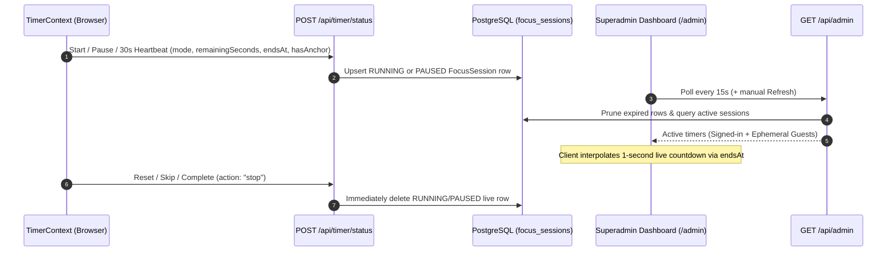

# Superadmin Telemetry & Privacy-First Command Center Guide

This document details the architecture, privacy safeguards, real-time timer telemetry, and administrative workflows for the **Do Not Disturb** Superadmin Command Center (`/admin`).

---

## 1. Overview & Design Philosophy

Because **Do Not Disturb** is built around a strict **Privacy-First** commitment (*"No Account Needed"*, *"Zero Tracking or Ads"*, *"Your attention is personal"*), the Superadmin view at `/admin` is engineered to provide high-signal platform health and live usage telemetry **without compromising personal user content or guest anonymity**.

Key architectural principles:
- **Zero-Migration Authorization**: Superadmin access is controlled via environment variable allowlisting (`SUPERADMIN_EMAIL` / `SUPERADMIN_EMAILS`) checked on the server.
- **Stealth Public Surface**: No links to `/admin` appear anywhere in the public navbar, footer, or account dropdowns, and `/admin` is configured with `robots: { index: false, follow: false }`. Non-superadmin visitors to `/admin` are silently redirected to `/`.
- **Plain, Unboxed Typography**: Matches the Serene Focus design language with clean tabular numerals and plain typography free of visual clutter, pills, or badges.

---

## 2. Authorization & Configuration

### 2.1 Environment Variables
Configure one or more superadmin email addresses in `.env`:

```env
# Single superadmin email
SUPERADMIN_EMAIL="owner@example.com"

# Optional comma-separated list of additional superadmin emails
SUPERADMIN_EMAILS="owner@example.com,ops@example.com"
```

### 2.2 Server-Side Verification
- [`isSuperAdminEmail(email)`](../lib/auth.ts) normalizes and matches the authenticated user's email against `SUPERADMIN_EMAIL` and `SUPERADMIN_EMAILS`.
- [`getSuperAdminUser()`](../lib/auth.ts) resolves the current session via [`getCurrentUser()`](../lib/auth.ts) and verifies superadmin membership.
- Both [`app/admin/page.tsx`](../app/admin/page.tsx) (within a `<Suspense>` boundary for `nextConfig.cacheComponents` compatibility) and all `/api/admin/*` route handlers enforce [`getSuperAdminUser()`](../lib/auth.ts).

---

## 3. Real-Time Active Timer Telemetry

To display **Active Timers (Live)** across both signed-in Cloud Sync users and local-only guests:



### 3.1 Ephemeral Local Guest Pulse
- When an unauthenticated visitor runs a timer, [`TimerContext`](../context/timer-context.tsx) generates a random tab-scoped token in `sessionStorage` (`dnd_ephemeral_pulse_id`, e.g., `anon_8f3k9a1b`).
- [`POST /api/timer/status`](../app/api/timer/status/route.ts) records an ephemeral `FocusSession` row with `userId: null` and `sessionCode: "#GUEST-3K9A1B"`.
- No cookies are set, no IP addresses or browser fingerprints are logged, and the row is immediately deleted when the timer stops or expires.

### 3.2 Isolation from Completed Session History
- [`fetchCloudSyncPayload`](../app/api/sync/route.ts) explicitly filters `status: { in: ["COMPLETED", "STOPPED"] }` so live `RUNNING` and `PAUSED` telemetry rows never leak into a user's historical session log.

---

## 4. Privacy-First Safeguards on `/admin`

| Safeguard | Implementation |
| :--- | :--- |
| **Redacted Focus Anchors** | Live timer pings never transmit raw `goal` or `intent` strings — only a boolean `hasAnchor` flag. The dashboard displays `Focus anchor set (text private)` or `Standard sprint`, plus an aggregate adoption percentage. |
| **Masked PII by Default** | User email addresses in both the Live Active Sessions table and the User Directory are masked by default (`ab***@domain.com`). Superadmins can toggle **Reveal emails** / **Mask emails** when needed for account support. |
| **`k`-Anonymized Blocker Leaderboard** | Only curated public distraction domains or domains blocked by **2+ distinct users** (`k >= 2`) are listed by name. Single-user custom URLs are grouped into a single summary row (`Private / Single-User Custom URLs (N redacted)`) so personal or workplace URLs are never exposed. |
| **Data Minimization & Pruning** | Expired `RUNNING` timers (>2 minutes past `endsAt`) and stale `PAUSED` timers (>2 hours untouched) are automatically cleaned up on every `/api/admin` read, with a manual **Prune orphaned & stale records** action (`POST /api/admin`) to purge unlinked rows. |

---

## 5. Dashboard Sections Reference

1. **Top KPI Row**:
   - **Cloud Sync Users**: Total registered accounts, weekly signup delta, and activation rate (percentage of users who have completed at least 1 focus session).
   - **Active Timers (Live)**: Total concurrent timers split by **Signed-In vs. Local Guests**, **Running vs. Paused**, and **Focus / Short Break / Long Break**.
   - **Platform Focus Hours**: Cumulative focused hours all-time, today's hours, and overall session completion rate (`COMPLETED` vs. early stop).
   - **Distractions Deflected**: Lifetime and daily deflection counts, active blocklist rule count, and `STRICT` vs. `SUSPEND` policy split.
2. **Live Active Timer Sessions**:
   - Filterable real-time table (`All`, `Signed-In`, `Local Guests`, `Running`, `Paused`, `Focus`, `Breaks`) with a live 1-second countdown and progress bar.
3. **Cohort Retention & 14-Day Platform Pulse**:
   - DAU (24h), WAU (7d), MAU (30d), DAU/MAU stickiness ratio, signup velocity, and an interactive 14-day bar chart toggling between **Focus Hours** and **New Signups**.
4. **Focus Protocols, Peak Rhythm & `k`-Anonymized Blocker Leaderboard**:
   - Protocol popularity bars, platform-wide 3-hour Peak Focus Window, 24-hour session start distribution, and the privacy-safe top deflected domains table.
5. **Zero-PII Sensory Adoption & Storage Hygiene**:
   - **Synthesized Soundscape Split**: Aggregate usage across `Rain`, `Binaural`, `Space`, `Waves`, and `Forest`.
   - **Visualizer & Flow Preferences**: Distribution of `Classic Arc Timer`, `Blooming Zen Garden`, and `Seasonal / Auto Theme`, plus `autoStartBreaks`, `autoStartFocus`, and focus anchor adoption rates.
   - **Cloud Sync Footprint**: Database table row counts (`FocusSession`, `BlockedWebsite`, `DeflectionEvent`), orphaned row counter, and one-click pruning.
6. **User Directory & Account Deletion**:
   - Searchable, filterable, and sortable roster of Cloud Sync accounts with a confirmation modal to permanently delete non-superadmin user accounts (`DELETE /api/admin/users/[id]`). Superadmin accounts are marked `Protected` and cannot be self-deleted.
